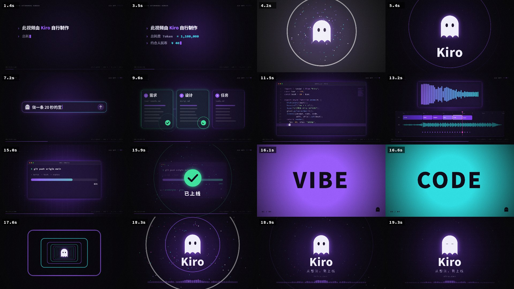

# Kiro 20 秒宣传片（Kiro 自行制作）

**成片：** [`kiro_promo.mp4`](kiro_promo.mp4)，规格 1920×1080 · 60fps · 20s · H.264 + Opus 立体声 · 约 35 MB



## 结构（120 BPM，每 2 秒一镜，切点都在拍上）
| 时间 | 画面 | 声音 |
|---|---|---|
| 0–4s | 打字机署名：此视频由 Kiro 自行制作 / Token / 费用 | 每个字一声键盘敲击、铺底 pad、riser、军鼓滚奏 |
| 4s | 白闪，冲击波和粒子，幽灵 Logo 弹出 | 低频 boom，四拍一底鼓进入 |
| 6s | 01 PROMPT：输入需求并发送 | 打字音效、发送提示音 |
| 8s | 02 SPEC：需求、设计、任务三张卡片依次打勾 | 加入琶音 |
| 10s | 03 CODE：代码按语法高亮逐行写出 | 加入十六分音符踩镲 |
| 12s | 04 EDIT：时间线、频谱、波形，都取自本片音轨 | 加入和弦 stab |
| 14s | 05 SHIP：`git push`，显示「已上线」 | 上行提示音 |
| 16–18s | VIBE / SPEC / CODE / SHIP 四个词快切，接加速隧道 | riser、越来越密的军鼓 |
| 18–20s | 最后重拍：Logo 和「从想法，到上线」 | 和弦一起落下，带混响尾音 |

## 制作方式
沙箱里没有 ffmpeg 编码器，也装不了 npm 或 pip 包，系统里没有中文字体（Noto Sans SC 是通过 GitHub API 拉下来的）。整个流程都在无界面 Chromium 里完成：
- **画面**：Canvas 2D 按时间 `t` 逐帧绘制，每一帧都是确定的，不会掉帧
- **音乐**：用 `OfflineAudioContext` 合成，底鼓、贝斯、pad、琶音、混响、延迟、压缩都由代码生成，没用任何采样
- **编码**：WebCodecs 编码 H.264（`avc1.64002A`）和 Opus，再由 `main.js` 里自己写的 MP4 封装器合成文件（faststart）
- **校验**：`verify.cjs` 把成片解码回来检查。4.0s 那一拍的声音出现在 4.006s，音画同步

## 重新渲染
```bash
node render.cjs --tokens "≈ 1,100,000" --cny "40" --out kiro_promo.mp4
node verify.cjs
```

## 关于 Token 和费用
片头的「≈ 1,100,000 Token / 约 ¥40」是**估算值**。视频必须在会话结束前渲染，所以只能提前估。估算方法：把每轮重复发送的上下文累加起来，按 Opus 公开价（输入 $5/M、输出 $25/M）计算，不计缓存，汇率约 7.1，所以这是上限。实际账单以平台为准。

> 音轨是 Opus（环境里没有 AAC 编码器）。Chrome、Edge、Firefox、VLC 和新版 Safari 都能直接播放；个别剪辑软件或微信可能需要先转成 AAC。
